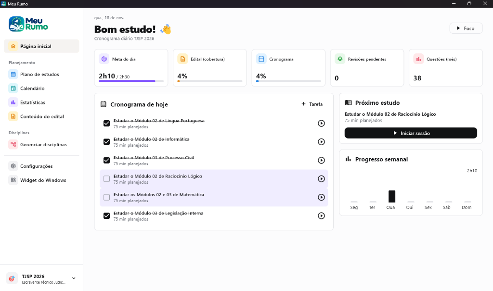
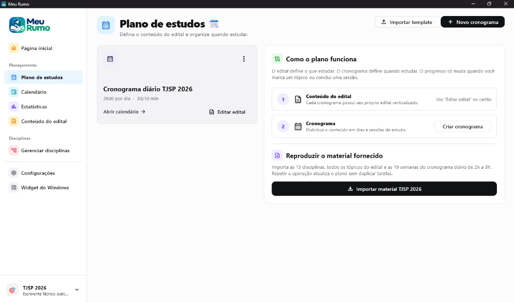
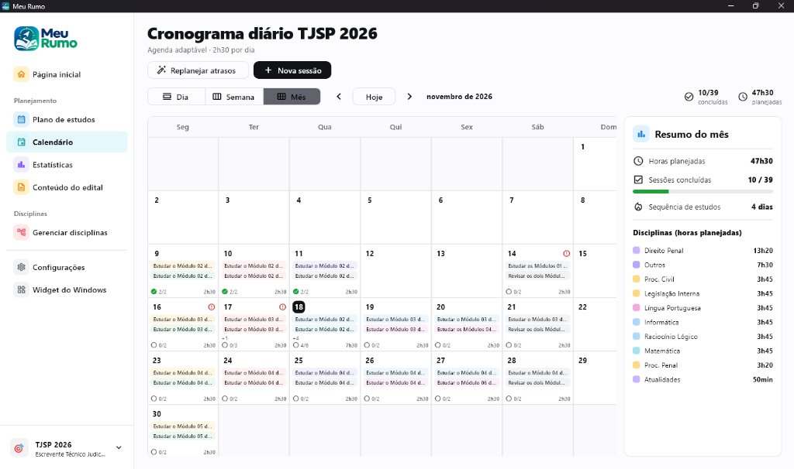
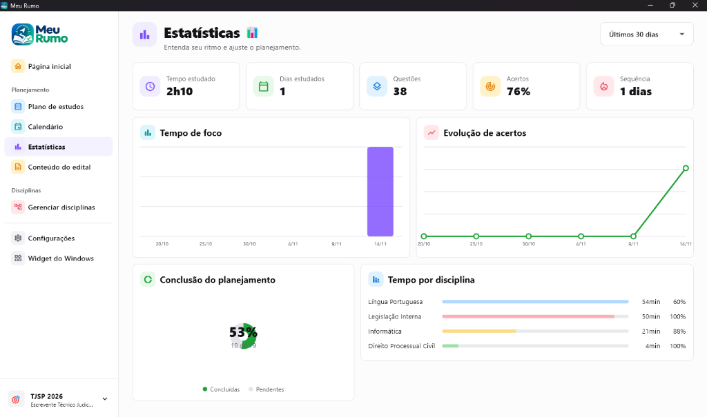
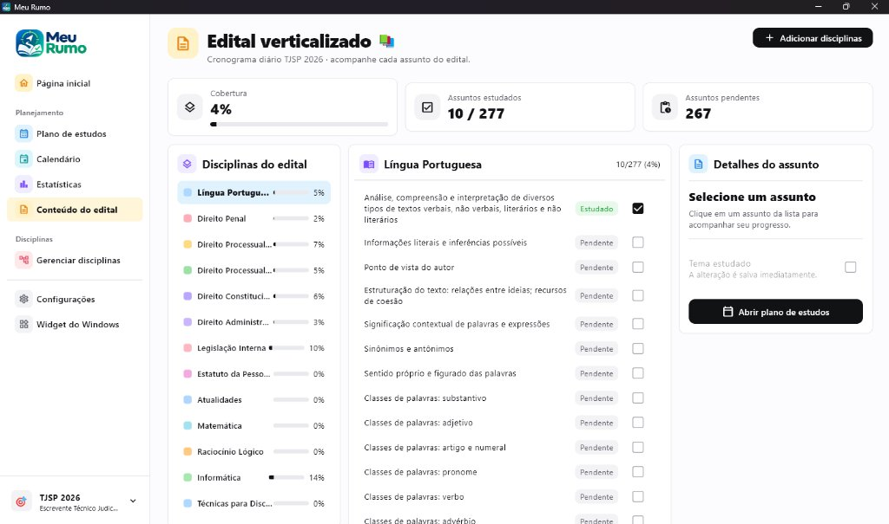
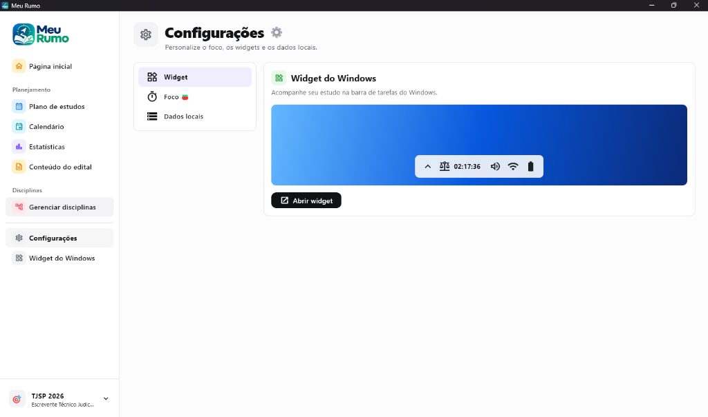
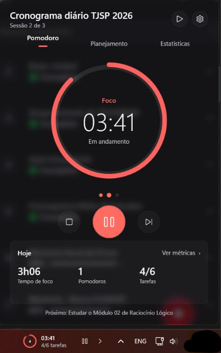

<div align="center">


### 🧭 Planejamento de Estudos Offline-First para Windows e Android

**Organize seu edital verticalizado, acompanhe seu cronograma diário, mantenha o foco com Pomodoro e visualize sua evolução — 100% local, sem conta e sem depender de internet.**

<p>
  
  
  
  
  
  
</p>

<p>
  <a href="#-visão-geral">✨ Visão Geral</a> •
  <a href="#-interface-e-funcionalidades">🖼️ Interface</a> •
  <a href="#-widget-nativo-do-windows">🍅 Widget Windows</a> •
  <a href="#-instalação-windows">📦 Instalação</a> •
  <a href="#-como-executar-em-desenvolvimento">🛠️ Desenvolvimento</a> •
  <a href="#-gerando-o-instalador">🚀 Build</a> •
  <a href="#-arquitetura-e-estrutura">🗂️ Arquitetura</a>
</p>

</div>

---

## ✨ Visão Geral

O **Meu Rumo** nasceu para resolver o caos de estudar para concursos e provas de longo prazo com planilhas soltas e aplicativos dependentes de nuvem. Tudo roda **localmente no seu dispositivo** com banco **SQLite**, interface limpa inspirada em workspaces modernos e integração nativa com a barra de tarefas do Windows.

### 🔥 Principais diferenciais

- 🔒 **100% Local e Offline**: seus dados ficam salvos no seu computador/celular em SQLite — sem login, sem mensalidade e sem risco de perder o ritmo sem internet.
- 🎯 **Edital Verticalizado Integrado**: acompanhe cada disciplina e assunto do edital com cobertura percentual em tempo real.
- 📅 **Agenda Adaptável com Replanejamento**: visualize por **Dia**, **Semana** ou **Mês** e replaneje sessões atrasadas com um clique.
- 🍅 **Modo Foco (Pomodoro) + Widget na Barra de Tarefas**: cronômetro dedicado dentro do app e painel translúcido nativo acoplado à barra de tarefas do Windows.
- 📊 **Métricas Reais de Desempenho**: acompanhe horas estudadas, sequência de dias, questões resolvidas, evolução da taxa de acertos e tempo investido por disciplina.
- 📦 **Instalador Windows 100% Autocontido**: não exige instalar `.NET`, `.NET Framework`, `Visual C++ Redistributable` nem privilégios de administrador.

---

## 🖼️ Interface e Funcionalidades

### 🏠 Página Inicial (Dashboard)

Visão rápida do seu dia de estudos assim que você abre o programa:

- ⏱️ **Meta do dia** com progresso visual em tempo real (`estudado / planejado`).
- 📑 **Indicadores-chave**: cobertura do edital, avanço do cronograma, revisões pendentes e questões resolvidas no mês.
- ✅ **Cronograma de hoje**: checklist interativo das sessões planejadas com botão rápido para iniciar o modo foco em cada tarefa.
- ▶️ **Próximo estudo & Progresso semanal**: acesso direto à próxima sessão e gráfico de constância da semana.

<p align="center">
  
</p>

---

### 📋 Plano de Estudos & Templates

Centralize um ou mais planos de estudo com total flexibilidade:

- ➕ **Criação de cronogramas** personalizados com carga horária diária e ciclos de Pomodoro configuráveis.
- 📤 **Importação de templates** para reutilizar estruturas de planejamento.
- 📥 **Importação rápida de material pronto** (como o plano **TJSP 2026** com 13 disciplinas, todos os tópicos do edital e 19 semanas de cronograma diário — sem duplicar tarefas ao reimportar).

<p align="center">
  
</p>

---

### 🗓️ Calendário & Agenda Adaptável

Planeje e acompanhe toda a sua rotina de estudos com clareza:

- 📆 **Três modos de visualização**: **Dia**, **Semana** e **Mês**.
- 🪄 **Replanejar atrasos**: reorganiza sessões pendentes automaticamente sem perder o histórico do que já foi concluído.
- 📈 **Resumo lateral do mês**: horas planejadas, sessões concluídas, sequência ativa de estudos e distribuição de horas por disciplina com código de cores.

<p align="center">
  
</p>

---

### 📊 Estatísticas e Desempenho

Entenda seu ritmo e ajuste o planejamento com base em dados concretos:

- 🕒 **Resumo do período** (filtrável, como *Últimos 30 dias*): tempo estudado, dias estudados, questões feitas, percentual de acertos e sequência de dias.
- 📉 **Gráficos interativos**: *Tempo de foco* diário, *Evolução de acertos* em questões e *Conclusão do planejamento*.
- 🎓 **Tempo por disciplina**: compare rapidamente quanto tempo e qual taxa de aproveitamento você teve em cada matéria.

<p align="center">
  
</p>

---

### 📚 Edital Verticalizado

Controle granular de cada ponto do conteúdo programático:

- 🎯 **Cobertura geral**, contagem de assuntos estudados vs. pendentes e barra de progresso individual por disciplina.
- ✔️ **Marcação instantânea**: marque assuntos como estudados com salvamento imediato no banco local.
- 🔍 **Painel de detalhes do assunto** e atalho direto para abrir o plano de estudos relacionado.

<p align="center">
  
</p>

---

### ⚙️ Configurações

Personalize a experiência do aplicativo em um só lugar:

- 🧩 **Widget**: ative e abra o widget nativo da barra de tarefas do Windows (ou widget da tela inicial no Android).
- 🍅 **Foco**: configure a duração das sessões de foco, pausas curtas, pausas longas e quantidade de rodadas por ciclo.
- 💾 **Dados locais**: gerencie o armazenamento SQLite local com segurança e confirmações explícitas.

<p align="center">
  
</p>

---

## 🍅 Widget Nativo do Windows

O **Meu Rumo** acompanha um widget nativo desenvolvido em **WPF (.NET 10)** que se acopla diretamente à **barra de tarefas do Windows**, permitindo controlar seu Pomodoro sem precisar alternar de janela:

- 🪟 **Painel flutuante translúcido** (efeito acrílico) com abas rápidas para **Pomodoro**, **Planejamento** e **Estatísticas**.
- ⏯️ **Controles instantâneos** de iniciar, pausar, parar e alternar para o descanso direto na barra de tarefas.
- 🔄 **Sincronização automática** com o banco SQLite local do aplicativo principal, exibindo tempo de foco, pomodoros concluídos, tarefas do dia e próximo estudo.
- 🚀 **Zero dependências externas**: empacotado como executável único autocontido (`win-x64`), funcionando em Windows 10 e Windows 11 sem precisar instalar `.NET`.

<p align="center">
  
</p>

---

## 📦 Instalação (Windows)

Para instalar em qualquer PC com **Windows 10 ou Windows 11 (64-bit)**:

1. Baixe o instalador `MeuRumo-Setup-0.1.0.exe` (gerado em `dist/` ou disponível em **Releases**).
2. Execute o instalador e siga o assistente em português.
3. Pronto! O programa é instalado em `%LOCALAPPDATA%\Programs\Meu Rumo` com atalhos opcionais no Menu Iniciar e Área de Trabalho.

### ✅ Por que funciona em qualquer Windows 10/11 sem passos extras?

| Característica | Detalhe |
| :--- | :--- |
| 🔓 **Sem privilégios de administrador** | Instalação por usuário (`PrivilegesRequired=lowest`) |
| 📦 **Runtime C++ embutido** | DLLs oficiais do Visual C++ CRT x64 acompanham o executável |
| 🟣 **Runtime .NET embutido** | Widget da barra de tarefas publicado em arquivo único autocontido (`net10.0-windows`) |
| 💾 **Dados preservados** | Atualizações e desinstalações **não apagam** seu banco SQLite em `%APPDATA%\br.com.studyplanner\study_planner\study_planner.sqlite` |

---

## 🛠️ Como Executar em Desenvolvimento

### Pré-requisitos

- **Flutter SDK** `3.10+` (Dart `3.10+`)
- **Visual Studio** com workload *Desenvolvimento para desktop com C++* (CMake + MSVC) — para Windows
- **.NET SDK 10.0+** — para compilar o widget nativo da barra de tarefas
- **Android SDK / JDK** — opcional, para compilação Android

### Comandos principais

```powershell
# 1. Instalar dependências
flutter pub get

# 2. Analisar código e rodar testes
flutter analyze --no-fatal-infos
flutter test

# 3. Executar no Windows
flutter run -d windows

# 4. Executar ou gerar APK no Android
flutter devices
flutter run -d <id-android>
flutter build apk --debug
```

---

## 🚀 Gerando o Instalador Windows

Para compilar o aplicativo em modo Release, embutir as DLLs do Visual C++ CRT, publicar o widget `.NET` autocontido e gerar o instalador final com **Inno Setup 6 ou 7**:

```powershell
.\scripts\build-release.ps1
```

O script automatiza todas as etapas:
1. 🔎 Lê a versão atual do [`pubspec.yaml`](pubspec.yaml).
2. 🧹 Limpa builds anteriores (`build/windows` e `dist/`).
3. 🧪 Executa `flutter pub get` e `flutter analyze --no-fatal-infos`.
4. 🏗️ Compila o aplicativo Flutter em `Release` para Windows x64.
5. 🧩 Copia automaticamente as DLLs do Visual C++ x64 CRT para execução app-local.
6. 🍅 Publica o widget da barra de tarefas em modo *single-file self-contained*.
7. 📦 Compila o instalador via Inno Setup (`installer/study-planner.iss`) e exibe o tamanho e hash **SHA-256** em `dist/MeuRumo-Setup-<versão>.exe`.

Mais detalhes em [`installer/README.md`](installer/README.md).

---

## 🗂️ Arquitetura e Estrutura

### Stack Tecnológica

- **UI Multiplataforma**: [Flutter](https://flutter.dev/) + `material_ui`
- **Gerenciamento de Estado**: [Riverpod 3](https://riverpod.dev/)
- **Navegação**: [GoRouter](https://pub.dev/packages/go_router)
- **Banco de Dados Local**: [Drift](https://drift.simonbinder.eu/) + SQLite
- **Widget Windows**: C# / WPF (.NET 10, `Microsoft.Data.Sqlite`, P/Invoke DWM Acrylic)
- **Instalador Windows**: [Inno Setup 7](https://jrsoftware.org/isinfo.php)

### Organização de Pastas

```text
Planner/
├── assets/images/             # 🎨 Ícone e logo oficiais do Meu Rumo
├── lib/
│   ├── app/                   # 🧭 App root, tema, router e componentes compartilhados
│   ├── core/
│   │   ├── database/          # 🗄️ Schema Drift, migrações e seeds (incl. TJSP 2026)
│   │   └── platform/          # 🪟 Integração Windows/Android e launchers de widgets
│   └── features/
│       ├── dashboard/         # 🏠 Página inicial e resumo diário
│       ├── schedules/         # 📋 Planos de estudo e templates
│       ├── planner/           # 🗓️ Calendário, agenda adaptável e sessão Pomodoro
│       ├── overview/          # 📊 Estatísticas e evolução de desempenho
│       ├── syllabus/          # 📚 Edital verticalizado
│       ├── catalog/           # 🏷️ Gestão de disciplinas e assuntos
│       └── settings/          # ⚙️ Configurações de widget, foco e dados locais
├── windows/
│   ├── runner/                # 🪟 Runner nativo Win32 e ícone multi-resolução
│   └── taskbar_widget/        # 🍅 Widget nativo WPF da barra de tarefas
├── android/                   # 🤖 Projeto Android e widget de tela inicial
├── installer/                 # 📦 Script Inno Setup e artes do assistente
├── scripts/                   # 🔧 Automação de build release e utilitários
├── docs/                      # 📖 Documentação técnica e capturas de tela
└── test/                      # ✅ Testes automatizados
```

### 📖 Documentação Técnica Complementar

- 🏗️ [Arquitetura do Projeto](docs/architecture.md)
- 🗄️ [Modelo de Banco de Dados](docs/database.md)
- 🎨 [Design System](docs/design-system.md)
- 🗺️ [Roteiro de Implementação](docs/implementation-roadmap.md)
- 🍅 [Documentação do Widget do Windows](windows/taskbar_widget/README.md)
- 📦 [Guia do Instalador Windows](installer/README.md)
- 📄 [Especificação Funcional](STUDY_PLANNER_SPEC.md)

---

<div align="center">
  Feito com 💙 e foco nos estudos — <strong>Meu Rumo</strong> 🧭
</div>
